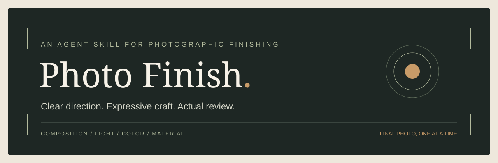

# 📷 Photo Finish

> Source-aware, natural photographic finishing for **non-portrait photos**.

[English](README.md) · [简体中文](README.zh-CN.md) · [繁體中文](README.zh-TW.md)

[](SKILL.md)
[](https://github.com/kwhi6693-web/photo-finish/releases/latest)
[](https://github.com/kwhi6693-web/photo-finish/actions/workflows/validate.yml)
[](LICENSE)
[](references/product-scope.md)
[](references/tone-color-foundations.md)



**Go to:** [Install](#install) · [Usage](#usage) · [Capabilities](#capabilities-and-limits) · [Compatibility](#host-compatibility) · [Docs](#documentation)

**Latest version and download: [GitHub Releases](https://github.com/kwhi6693-web/photo-finish/releases/latest).** Publishing a new release does **not** automatically upgrade a Skill already installed in an agent host.

**Published stable: v1.5.6.** Python 3.11+ and Pillow 13.0.0+ are required for this release. The prior published v1.5.5 remains available and unchanged. Four functional layers retain autonomous photographic direction; successful replies display the final photo directly. The [25-style reference catalog](references/style-catalog.md) is interpretive guidance, not Apple presets or universally verified effects.

## 🎯 What it is

Photo Finish helps an authorized agent inspect a photograph, choose a photographic direction, edit it using an **available real image tool**, compare the result against its source, and deliver an actual verified file when saving is supported.

**Intended scenes:** nature and landscapes, architecture, city nights, travel, still life, food, and product photography. It is **not a portrait-retouching Skill**: no face beautification, skin smoothing, facial reshaping, or dedicated portrait optimization. Incidental people in non-portrait scenes remain protected. [Full product scope](references/product-scope.md).

The goal is credible light, color, visual hierarchy, and natural texture—not one universal preset or a guarantee that every photograph will improve.

## ⚡ Install

1. Visit the [latest GitHub Release](https://github.com/kwhi6693-web/photo-finish/releases/latest) and download the **installable Skill ZIP** and the **matching SHA-256 checksum** from the attachments on that page.
2. Verify the checksum, then extract and install the complete `photo-finish/` folder using your host's **supported** Skill installation flow. Keep `SKILL.md`, `runtime/`, `references/`, `scripts/`, `agents/`, and `assets/` together.
3. Confirm that the host **actually loads** the intended version and preserves every original file byte.

Use the **Release attachment**, not GitHub's auto-generated source archive. The repo's `dist/photo-finish.zip` is a **historical v1.5.1 package**, not the latest release installer. A locally verified extraction does not by itself prove a safe ChatGPT-host upgrade. **v1.5.6 acquisition safeguards:** HTTPS/443 and public-address checks with pinned connections, up to five validated redirects, a 64 MiB body limit and a total deadline; ambient proxies are not used. Live provider compatibility is not universally verified.

## 📸 Usage

```text
Use $photo-finish to edit this landscape photo. Choose its best style and composition automatically.
Please edit, inspect, save, and deliver the non-portrait photo I am about to upload.
Keep the lettering and buildings unchanged; improve light and color.
Make the saved V1 more natural without losing its detail.
Restore V1 from the existing file without editing it again.
```

Photo-only automatic invocation is *intended* by the Skill but **depends on real host behavior**; it is not universally verified. Some editing tools require explicit permission to act on your behalf. A photo upload, an interactive preview, or a style preference alone is not proof of that permission or of confirmed saving. Follow any tool-required **STOP** condition.

**Default delivery:** one final photograph displayed directly; version/save evidence remains internal, with text only when requested or needed for failures/pending states. If no meaningful quality improvement, safe content-preserving route, or verified output exists, report the failure instead of registering a false V1.

## 🧭 Four functional layers

The v1.5.6 workflow groups existing capabilities into **four functional layers**, not four new mandatory tool calls. Everyday edits run through the first three; the fourth supplies only the relevant personal context and safeguards.

| Layer | What it does | Default behavior |
|---|---|---|
| **1. Photographic direction** | Inspect subject, spatial story, light, color and materials; choose the strongest suitable style and composition; check optional personal references | Select one professional direction without asking the user to pick a preset or rendering several candidates |
| **2. Editing and review** | Choose an actually available, authorized native or creative editing route; compare the result against the original and protected details | No accepted V1 until the expressive goal and content checks pass |
| **3. Final photo and versions** | Validate actual output bytes, deliver the final image, record verified saving and revisions, and restore an existing version without re-rendering | **Show one accepted final photo directly**; keep status, parameters and comparison internal unless requested or needed to explain a problem |
| **4. Personal assets and safeguards** | Optional style collection, preferences, backups, scoped recovery and safe failure handling | Read only relevant saved references; never auto-collect new photos or run the full asset-management workflow |

**Normal path:** inspect photo → retrieve only relevant preferences/references → choose expression and framing → edit using a real tool → compare with the source → verify and deliver the accepted final photo. The controller records evidence but **does not itself render, visually judge, or save through a host without real tool support**.

### Autonomous style and composition

Photo Finish aims to **choose the look that best expresses each uploaded image**, rather than impose a fixed color grade. Photographic direction can retain, refine or substantially reframe an existing composition, and can consider aspect ratio, light hierarchy, white balance, selective color, black-and-white and texture. A strong original composition may also be left untouched. Neither a preset name nor the amount of editing proves improvement.

The personal style library is an **optional source of evidence**: when relevant, retrieve and actually inspect up to three suitable references, adopt them in whole or in part, or reject them with reasons. An empty library never blocks editing. Explicitly requested references that cannot be accessed are reported rather than silently substituted.

### Optional style and texture catalog

The [v1.5.6 catalog](references/style-catalog.md) defines **16 photographic-style references** and **9 traditional-filter references**, with separate IDs where names overlap:

- **Photographic styles (16):** Standard, Cool Rose, Neutral, Rose Gold, Gold, Amber, Bright, Vibrant, Natural, Luminous, Dramatic, Quiet, Cozy, Ethereal, Muted Black & White, Stark Black & White.
- **Traditional filters (9):** Vivid, Vivid Warm, Vivid Cool, Dramatic, Dramatic Warm, Dramatic Cool, Mono, Silvertone, Noir.
- **Independent texture choices:** original texture, glow, film-like treatment and optional grain—**only where the real image tool can actually produce and verify the requested result**.

These are **Photo Finish's own visual reference definitions**, informed by publicly described concepts—not Apple preset files, LUTs, the native iPhone engine, verified slider equivalents, or proof of a complete iPhone 18 Pro effects inventory. The catalog is not an automatic checklist: ordinary editing need not load every style or render variants. The best result may combine a reference with a custom direction or use no named style.

Creative reconstruction, removal of minor distractions, or atmosphere changes are considered only when appropriate to the user's scope and supported by a real tool. Protect recognizable identity, critical lettering/seals, product information and event facts; record creative changes rather than presenting them as untouched documentary reality. Host authorization, tool-required **STOP**, protected-content checks and truthful delivery remain binding.

## ✨ Capabilities and limits

| Area | Available capability | Boundary |
|---|---|---|
| Light and color | Real non-generative global adjustments, demonstrated on specific nature, architecture, and travel photos | Scene-specific success is not universal quality assurance |
| Composition and content | Independent photographic judgment, comparison, and protection of meaningful structures, lettering, textures, and incidental people | Generation cannot promise pixel-identical reconstruction |
| Local retouching | Host selection/mask interfaces when supported and actually verified | Complex canopy/sky boundaries, feathering, and reliable non-target protection remain restricted |
| Personal style library | Explicit save, search, labels/groups, preferred uses, and up to three suggested references | No automatic collecting; an adopted reference is not proof of quality gain |
| Editing preferences | Optional long-term rules, scene-specific settings, temporary overrides, undo | One-time requests do not silently change saved rules or grant editing permission |
| Versioned delivery | Existing-file V1/V2 revisions, source/output SHA-256, comparison, safe rollback, and explicit save receipts | Preview, visual approval, persistence, and registration are separate facts |
| Scoped private recovery (v1.5.3) | Archive/member verification, independent-session **read-only** retrieval, and recovery views in a new private target | Requires verifiable host handoff credentials and **one writer** |

**Not proven as general-purpose results:** dedicated professional denoising, real deblurring, super-resolution, complex night-sky restoration, or precision edge matting. Synthetic tests and CI verify software behavior, not photographic quality. [Quality evidence](docs/QUALITY_STATUS_1_5_2.md) · [Validation scope](docs/validation.md).

### Recovery status

v1.5.3's private archival/recovery contract is **limited**. Unknown outcomes, absent credentials, conflicting file identities, and unowned destinations must stop safely; identical re-entry reuses actual evidence instead of blindly re-uploading or overwriting history.

Two host-level P0 cases are **excluded**: authoritative reconciliation after **all** local state and handoff credentials are lost, and cross-session **same-series multi-writer coordination**. No unattended/background archival, indefinite retention, or complete Phase 5 reliability promise. **Full Phase 5: NO-GO.** See the [changelog](CHANGELOG.md) and [historical release preparation](docs/RELEASE_1_5_3_PREPARATION.md).

### Host compatibility

A real host must provide image inspection, an authorized image-editing tool, formal output bytes, and trustworthy save receipts. Python dependencies do not provide hosted image processing or durable cloud storage.

Historical installation note: an earlier host upgrade modified the SVG and was blocked. Subsequent private installation records document byte-preserving upgrades through v1.5.5; neither those records nor isolated Python loading certify installation of the published v1.5.6 release. Verify every original file byte in each actual host installation. Historical failure reports remain dated evidence.

## 🎨 Personal styles, rules, and privacy

These features are **optional**. When the private library is empty or no reference fits, the agent can work from the current photo.

- **Style collection:** “Save this as *Soft wood interiors*; I like its light.” Collect only with explicit user intent. [Style library](references/personal-style-library.md).
- **Saved rules:** “Remember that I like natural tonal separation.” One-off overrides remain one-off. [Custom instructions](references/custom-instructions.md).
- **Private backup:** export, inspect, or import photos, metadata, rules, and undo history when requested. [Backup guide](references/private-backup.md).

Photos, references, personal preferences, session records, credentials, and private Library IDs must remain **outside the installation and public repository**. Host-provided persistence requires real receipts; temporary directories or displayed attachments alone are not durable storage. No bundled cloud-sync, telemetry, or account service is claimed. [Security policy](SECURITY.md).

## 🧰 Developer notes

```bash
git clone https://github.com/kwhi6693-web/photo-finish.git
cd photo-finish
python -m venv .venv
# Activate the environment using your shell's normal command.
python -m pip install -r requirements.txt
python tools/doctor.py
```

For development, tests, and publishing, see [contributing](CONTRIBUTING.md), [validation](docs/validation.md), and [releasing](docs/releasing.md). Keep private photos and ledgers out of test fixtures and public artifacts.

## 📚 Documentation

| Topic | Guide |
|---|---|
| Feature map and design | [Architecture](docs/architecture.md) · [Product scope](references/product-scope.md) |
| Workflow and controller interfaces | [Runtime](docs/runtime.md) · [Delivery adapter](references/delivery-adapter.md) |
| Realistic photo treatment and protection | [Tone/color](references/tone-color-foundations.md) · [Fidelity](references/fidelity-and-retouch.md) |
| Personal reference and instructions | [Style library](references/personal-style-library.md) · [Preferences](references/custom-instructions.md) |
| Private migration and recovery | [Backup](references/private-backup.md) |
| Releases, validation, and security | [Changelog](CHANGELOG.md) · [Validation](docs/validation.md) · [Security](SECURITY.md) |

## 🔒 License

[MIT](LICENSE) © 2026 kwhi. See [third-party notices](THIRD_PARTY_NOTICES.md). User images and third-party materials retain their own rights.
