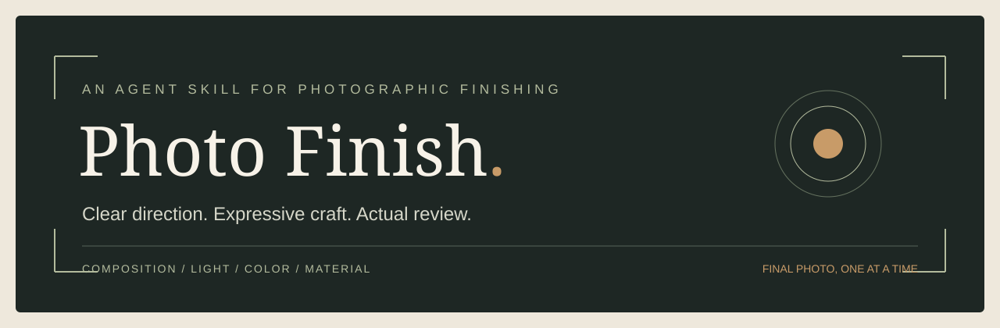

# 📷 Photo Finish

> Give every photograph a clear direction, expressive light and color, and a believable photographic finish.

[English](README.md) · [简体中文](README.zh-CN.md) · [繁體中文](README.zh-TW.md)

[](SKILL.md)
[](docs/validation.md)
[](https://github.com/kwhi6693-web/photo-finish/actions/workflows/validate.yml)
[](LICENSE)



**Jump to:** [Quick Start](#quick-start) · [Capabilities](#capabilities) · [Compatibility](#compatibility) · [Privacy](#privacy) · [Validation](#validation)

## ⚡ Quick Start

Install this repository as the `photo-finish` skill in your agent's skill directory. Keep `SKILL.md`, `references/`, `scripts/`, `agents/`, `assets/` and **`runtime/` together**; the runtime is included, so no private Library or recovery ZIP is required.

```text
Use $photo-finish to edit this photograph.
```

The agent examines the actual source, develops photographic direction, edits through an available image tool, inspects the result, and makes targeted corrections when needed. **Default delivery: one final photograph at a time.** Originals, comparisons, parameters and reports stay internal unless requested.

For a local checkout:

```bash
git clone https://github.com/kwhi6693-web/photo-finish.git
cd photo-finish
python -m venv .venv
# Activate the environment using your shell's normal command.
python -m pip install -r requirements.txt
python tools/doctor.py
```

Python dependencies do not provide an image generator. The host agent must supply visual understanding, an authorized image-editing tool, and file access. The skill does not collect API keys or silently install tools.

## ✨ Capabilities

| Direction | Craft | Review | Delivery |
|---|---|---|---|
| Source-aware intent and reference decisions | Composition, light, color, local retouching and material treatment | Full-frame expression plus affected native-detail checks | One final photograph; separate quality and save evidence |

- **Expressive by default.** Make the visual intention evident through hierarchy, tonal separation, palette and texture. A tiny exposure adjustment is not the default finish line.
- **Composition freedom.** Preserve, optimize or reframe; crop, aspect ratio and visual center follow the photograph rather than a fixed preset.
- **Believable photography.** Check spatial logic, reflections, perspective, material detail, halos, smearing and repeated synthetic texture. This does not require low contrast or muted color.
- **Protect meaningful content.** Preserve recognizable identity, artwork, inscriptions, stamps and key facts according to the locked task requirements. Ordinary lettering follows the visible source; ambiguous strokes are not invented.
- **References when useful.** Use authorized references as evidence, not an aesthetic ceiling. An empty or unsuitable reference library goes directly to professional source-based judgment.
- **Real execution records.** Bind source/output hashes, actual tool arguments, protection strategy, observed review, corrections and timing. Do not call a plan a photograph.

## 🧭 How It Works

The bundled controller groups routine work into four calls. It records the agent's actual work; it neither renders photographs nor certifies visual judgment automatically.

| Stage | Controller | Required real work |
|---|---|---|
| Understand | `photo_edit.py prepare` | Inspect the source; specify intent, hierarchy, light/material and review focus |
| Commit direction | `photo_edit.py submit` | Select references, lock protected content, record the complete tool request |
| Acquire | `photo_edit.py returned` | Execute the actual editing tool once; inspect formal returned bytes |
| Review | `photo_edit.py review` | Compare source and output, inspect affected details, resolve visible issues |

Read the [runtime guide](docs/runtime.md) for executable examples, [the complete policy](runtime/我的照片美化偏好与修图标准.md) for behavior, and [the adapter contract](references/delivery-adapter.md) only when its fields are needed.

## 🧩 Compatibility

| Capability | Requirement / boundary |
|---|---|
| Agent | Visual source/output inspection and instruction-following |
| Image editing | A real host-provided editor or reference-aware image-generation tool |
| Controller | Python 3.10+ and Pillow; local Linux/Python 3.12 evidence is reported separately from CI |
| Color | Interpret supported declarations; an explicit bounded screen-sRGB assumption is not calibrated color or print certification |
| Exact text or identity | Use a route that can preserve the protected content; generated reconstruction cannot pass an exact-content requirement |
| Saving | Host-specific; presentation, scoped quality acceptance and confirmed durable saving are different facts |
| Optional tools | Lightroom, RAW decoding, numerical analysis, grids and captions only when applicable and available |

The public reference index starts empty. The optional numerical baselines and XMP files are designed starting settings, not measured author settings, an obligatory look, or proof of Adobe import/render compatibility. RAW, print and identity-sensitive portrait results need task-specific verification.

## 🔒 Privacy

The repository contains workflow code, policies, optional presets and synthetic tests. **No private reference photographs, user uploads, generated personal images, Library IDs, session records, credentials or machine-specific paths are distributed.**

Keep images, ledgers, signed result URLs and save receipts outside the installation directory. Image providers receive photographs only through the host tools you authorize; the skill itself installs no daemon, telemetry or upload service. A fresh public Git history prevents accidental publication of the private workspace's earlier commits.

See [SECURITY.md](SECURITY.md) for the disclosure route and [the publication audit](docs/security-audit.md) for check scope and limitations.

## ✅ Validation

```bash
python tools/doctor.py
python tools/check_publication.py
python tools/run_tests.py
python tools/build_release.py --output dist/photo-finish.zip
```

The package builder uses an allowlist, rejects unsafe entries, writes deterministic archives and includes MIT license/attribution. Checks cover policy/hash consistency, empty-library fallback, source/output identity, protection contracts, atomic failure behavior, color scope, save-state separation and reproducible extraction. Synthetic tests exercise contracts; they are not real-photo quality evidence. See [validation scope](docs/validation.md).

## 🤝 Contributing

Read [CONTRIBUTING.md](CONTRIBUTING.md). Keep the ordinary edit path light, preserve actual visual review, and never add private photographs or credentials to tests or examples. A ⭐ helps others discover the project if it is useful to you.

## License

[MIT](LICENSE), copyright © 2026 kwhi. Method references and dependency boundaries are listed in [THIRD_PARTY_NOTICES.md](THIRD_PARTY_NOTICES.md). User photographs remain subject to their own rights; this license does not grant rights to third-party images or services.
