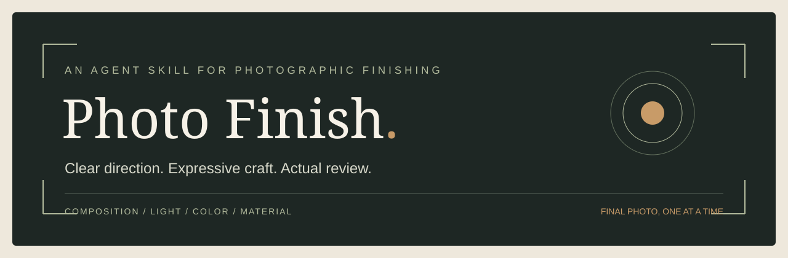

# 📷 Photo Finish

> 专注**非人像摄影**的自然照片美化：从光影、色彩、真实质感到可核验的正式交付。

[English](README.md) · [简体中文](README.zh-CN.md) · [繁體中文](README.zh-TW.md)

[](SKILL.md)
[](https://github.com/kwhi6693-web/photo-finish/releases/latest)
[](https://github.com/kwhi6693-web/photo-finish/actions/workflows/validate.yml)
[](LICENSE)
[](references/product-scope.md)
[](references/tone-color-foundations.md)



**快速导航：**[下载安装](#下载安装) · [如何使用](#如何使用) · [能力与限制](#能力与限制) · [宿主兼容性](#宿主兼容性) · [技术文档](#技术文档)

**最新版下载：前往 [GitHub Releases](https://github.com/kwhi6693-web/photo-finish/releases/latest) 查看最新正式版本并选择安装附件。** GitHub 发布新版本**不等于**已安装 Skill 自动更新。

**当前正式版本：v1.5.6，已发布。** 本版本要求 Python 3.11+、Pillow 13.0.0+；历史正式版 v1.5.5 保持不变。四大功能层保留自主摄影判断，成功交付默认直接显示成片。[25项风格参考](references/style-catalog.md)不是苹果原生预设，也未经全目录实图验收。

## 🎯 产品定位

Photo Finish 是 Agent Skill，帮助获得授权的智能体理解摄影原片、确定处理方向、借助**真实可用的图像工具**编辑、对照复核，并在宿主支持时交付经过文件核验的正式成片。

**适用场景：**自然风光、城市夜景、建筑、旅行、静物、美食和产品摄影。**不处理以人物为主体的人像专门修图**，不开发磨皮、美颜、五官调整或塑形功能。非人像照片中偶然出现的人物须保留身份与重要内容。[完整产品定位](references/product-scope.md)。

目标是自然可信的光影、色彩、主次层次和材质，而不是统一滤镜或保证每张照片都能改善。

## ⚡ 下载安装

1. 前往 [GitHub Releases 最新正式发布页](https://github.com/kwhi6693-web/photo-finish/releases/latest)，在该版本的附件中下载**完整 Skill 安装 ZIP**及**对应的 SHA-256 校验文件**。
2. 验证 ZIP 哈希后，按照宿主**正式支持的安装流程**放置完整的 `photo-finish/` 目录。`SKILL.md`、`runtime/`、`references/`、`scripts/`、`agents/`、`assets/` 必须一起保留。
3. 核对宿主**实际加载版本**及安装后全部原文件字节是否一致。

应下载 GitHub Release **正式附件**，不是 GitHub 自动生成的 Source code ZIP。仓库内的 `dist/photo-finish.zip` 是历史 **v1.5.1** 安装包，**不是最新版安装包**。隔离解压成功也不能证明 ChatGPT 真实宿主升级成功。**v1.5.6 下载安全边界：**仅 HTTPS/443、公开网络地址核验与已检查 IP 固定连接；最多五次校验后的跳转、64 MiB 下载上限及总截止时间；不使用环境代理。真实图像提供方兼容性尚未得到全面验证。

## 📸 如何使用

```text
使用 $photo-finish 美化这张自然风景照片，自动选择最合适的风格与构图。
请直接修图、检查、保存并交付我接下来上传的非人像照片。
保留建筑结构和可见文字，只改善光影与色彩。
把已经保存的 V1 稍微处理得更自然，保留原始纹理。
直接读取之前的 V1 文件恢复，不重新渲染。
```

上传非人像照片**可能**在兼容宿主中触发 Skill，但“只上传照片就自动触发”仍取决于**真实宿主行为**，并未证明所有环境均可触发。某些图像工具需要明确代操作授权；仅上传照片、提供审美偏好或出现交互预览，都不能代替授权和正式保存回执。必须遵守工具的 **STOP** 要求。

**默认交付：**直接显示一张最终成片；版本与保存凭据内部保留，异常或待确认状态简短如实说明。若摄影改善不足、内容保护不合格或无法取得可核验文件，应如实拒绝，不能虚构成功的 V1。

## 🧭 四大功能层与执行流程

v1.5.6 将现有能力整合成**四个功能层**，并不意味着每次修图要新增四次工具调用。日常工作主要使用前三层，第四层仅提供必要的个人资料与保障。

| 功能层 | 职责 | 默认行为 |
|---|---|---|
| **① 摄影决策层** | 观察主体、空间叙事、光影、色彩和材质；自主选择适合的风格、构图与处理方向；按需参考个人风格 | 不要求用户挑滤镜，不默认生成多张候选 |
| **② 编辑与验收层** | 依据实际授权与工具能力选择原生或创意编辑路线；对照原片检查表达效果和关键内容 | 摄影目标或内容保护未通过，不登记正式 V1 |
| **③ 成片与版本层** | 校验正式文件、直接交付成片、核对保存回执、登记版本与无渲染回退 | **默认仅直接显示一张最佳正式成片**；参数、过程和对比仅按需提供 |
| **④ 个人资产与保障层** | 私人风格库、个人规则、备份、限定恢复和安全处理 | 只读任务相关资料，不自动收藏照片或执行完整管理流程 |

**日常执行路径：**观察原片 → 按需读取偏好与参考 → 确定摄影风格和构图 → 真实工具编辑 → 同源原片对照验收 → 文件核验与成片交付。控制器负责流程和证据，**本身不会渲染图像、替代审美判断或绕过宿主能力完成保存**。

### 自动选择风格与创作自由

Photo Finish 默认针对**每张原片的主体、现场光线、空间关系、材质和情绪，自主挑选最适合表达画面的一种摄影方向**，而非强行套统一预设。构图可保留、微调或明显重构；画幅、裁切、透视、明暗主次、冷暖、色彩强度、黑白与质感由实际画面和当次要求决定。原片本来优秀时，也允许有依据地保持不变；不以变化幅度判断成片质量。

个人风格库仍参与决策，但**不是强制阶段**：必要时检索并实际查看最多三张适合的授权参考，选择采用、部分借鉴或不采用。没有合适参考可以完全依据原片完成；用户明确指定的参考无法读取时如实说明，不自行替换。

### 可选风格、滤镜与质感

[新版风格目录](references/style-catalog.md)提供 **16 种摄影风格参考**和 **9 种传统滤镜参考**，同名项目通过独立 ID 区分：

- **摄影风格（16）：**标准、冷调玫瑰色、中性、玫瑰金色、金色、琥珀色、珠光、鲜明、自然、耀目、反差色、安静、温馨、缥缈、暗色黑白、黑白对比。
- **传统滤镜（9）：**鲜明、鲜暖色、鲜冷色、反差色、反差暖色、反差冷色、单色、银色调、黑白。
- **独立质感选择：**保留原有质感、柔和光晕、胶片感及可选颗粒；仅在实际编辑工具支持并能够获得正式核验结果时使用。

这 **25 项是 Photo Finish 自定义的摄影意图与视觉参考**，不是苹果原生滤镜文件、LUT、iPhone 调色引擎、精确滑块参数，也不代表 iPhone 18 Pro 全量效果已完成实机核对。风格库仅按任务需要读取，**不要求每张图片遍历全部风格、追加工具轮次或制作多种成片**；最合适的方向也可以是目录之外的独立创作。

若有明确的创作目的且工具能力允许，可调整画面叙事、清理非关键干扰或进行受控的氛围演绎；这些操作须如实记录，不能伪装成未经修改的现场事实。始终保护可识别身份、关键文字和印章、产品信息与事件事实；纪实、证据与档案照片优先尊重真实性要求，工具授权与 **STOP** 规则不因创作自由而失效。

## ✨ 能力与限制

| 方向 | 已具备的能力 | 必须如实说明的边界 |
|---|---|---|
| 光影与调色 | 已有真实非生成式全局调整及部分自然、建筑、旅行单样本成功案例 | 单样本通过不等于所有场景质量保证 |
| 构图与内容保护 | 专业方向判断、原片对照、建筑文字与自然纹理等内容检查 | 生成重建无法保证逐像素保真 |
| 局部精修 | 宿主实际可用且经过核验时使用选区或 `maskURI` | 复杂天空/树冠交界、羽化及非目标保护仍受限制 |
| 个人风格库 | 明确授权后收藏、命名、分组、搜索及选取最多三张参考 | 不自动收藏；引用参考不代表质量提升 |
| 自定义指令 | 可选全局、场景规则、当次覆盖与修改撤销 | 临时要求不会自动写入长期偏好或授予工具权限 |
| 版本交付 | 真实文件 SHA-256、V1/V2 修订、前后对比、旧文件回退与保存核验 | 预览、质量接受、持久保存和版本登记是不同事实 |
| 私有归档（v1.5.3） | 限定范围归档、完整哈希回读、独立会话**只读**取回、新私有位置的版本视图恢复 | 需要可验证的宿主交接凭据与**单写入者** |

**尚未证实具有普遍效果：**专业独立降噪、真正去模糊、超分辨率、复杂夜景天空恢复与精密边缘抠图。自动测试与 CI 证明软件契约，不等于真实照片审美保证。[v1.5.2 质量证据](docs/QUALITY_STATUS_1_5_2.md) · [验证范围](docs/validation.md)。

### 恢复的支持边界

v1.5.3 的归档与恢复能力仅在**真实可验证的宿主凭据、准确文件身份和单写入者**条件下成立。上传结果未知、凭据丢失、身份冲突或目标不属于当前任务时必须安全停止，不盲目重传或覆盖历史。

仍明确排除两个宿主级 P0：**全部本地操作状态及交接凭据丢失后的权威对账**，以及**跨会话同系列的多写入者协调**。不承诺无人值守后台归档、无限期存储或第五阶段完整长期稳定性。**第五阶段整体仍为 NO-GO。**[更新记录](CHANGELOG.md) · [历史发行准备证据](docs/RELEASE_1_5_3_PREPARATION.md)。

### 宿主兼容性

真实宿主必须具备看图、调用获授权的图像编辑工具、读取正式输出字节以及可信保存回执的能力。仅安装 Python 依赖不会得到云端图像编辑服务或长期存储。

历史安装说明：早期宿主曾因SVG字节变化中止升级；后续私有安装记录记载了直至v1.5.5的完整字节升级。此历史不代表已发布的v1.5.6已安装；每次真实宿主安装仍须核对全部原始字节。

## 🎨 个人风格规则与隐私

这些都是**可选功能**。私人风格库为空或没有适用参考时，仍可直接根据原片作专业判断。

- **风格库：**“把这张收藏为「柔光木质」，喜欢它的自然光线。”只有明确授权才能收藏。[风格库说明](references/personal-style-library.md)。
- **个人规则：**“记住我偏好自然的明暗层次。”一次性调整不会自动成为长期规则。[自定义指令](references/custom-instructions.md)。
- **私人备份：**按需导出、检查和导入照片、元数据、个人规则与修改历史。[备份与恢复](references/private-backup.md)。

个人照片、风格、偏好、账本、凭据和私人 Library ID **不进入公开仓库或 Skill 安装目录**。持久保存取决于真实宿主能力及回执；临时路径或展示的附件不能单独证明长期保存。Skill 不内置云同步、遥测或用户账号服务。[安全说明](SECURITY.md)。

## 🧰 开发者说明

```bash
git clone https://github.com/kwhi6693-web/photo-finish.git
cd photo-finish
python -m venv .venv
# 按终端环境正常激活虚拟环境。
python -m pip install -r requirements.txt
python tools/doctor.py
```

开发、测试与发布细节见[贡献指南](CONTRIBUTING.md)、[验证说明](docs/validation.md)及[发布流程](docs/releasing.md)。不得把私人照片或账本写入公开测试资料。

## 📚 技术文档

| 需要了解 | 资料 |
|---|---|
| 功能与产品范围 | [架构](docs/architecture.md) · [非人像范围](references/product-scope.md) |
| 执行与交付接口 | [运行指南](docs/runtime.md) · [交付协议](references/delivery-adapter.md) |
| 摄影美学与内容保护 | [光影色彩依据](references/tone-color-foundations.md) · [保真精修](references/fidelity-and-retouch.md) |
| 参考风格与个性规则 | [风格库](references/personal-style-library.md) · [自定义指令](references/custom-instructions.md) |
| 私人迁移与恢复 | [备份恢复](references/private-backup.md) |
| 发行、验证和安全 | [更新记录](CHANGELOG.md) · [验证](docs/validation.md) · [安全说明](SECURITY.md) |

## 🔒 许可证

[MIT](LICENSE) © 2026 kwhi。[第三方声明](THIRD_PARTY_NOTICES.md)。用户照片及第三方素材各自保留原有权利。
