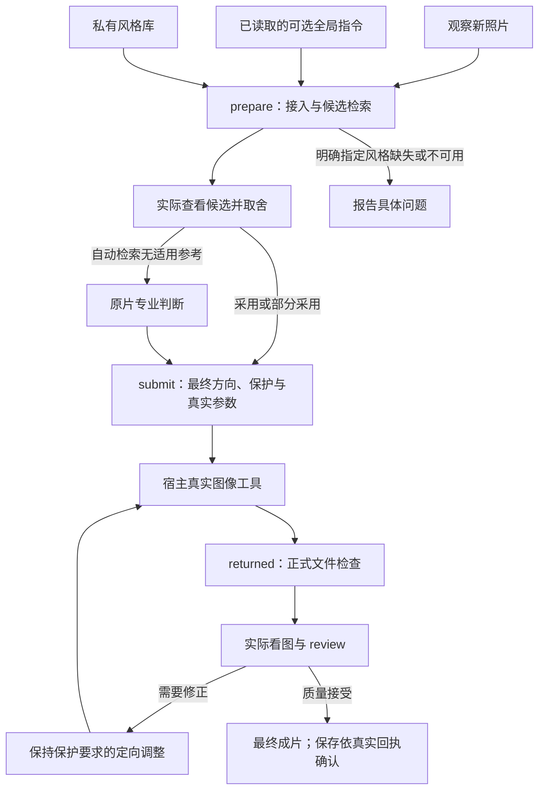

# 功能、架构与资料导航

当前流程：**观察原片、读取可选指令 → 检索个人风格库 → 实际查看并取舍 → 确定最终方向 → 真实美化 → 复核 → 成片交付**。

## 主要功能

| 模块 | 当前能力 | 执行依据 |
|---|---|---|
| 个人风格库 | 明确收藏、原字节去重、关键词/ID/分组检索、编辑、置顶、用途限定与翻页 | [风格库接口](../references/personal-style-library.md) |
| 可选全局指令 | 长期规则、偏好、场景启停、临时覆盖、结构化冲突检查、最近 20 次撤销 | [自定义指令](../references/custom-instructions.md) |
| 专业修图 | 参考判断后确定构图、光影、色彩、材质和氛围；未限定部分专业自主处理 | [专业工作流](../references/professional-workflow.md) |
| 内容保护与复核 | 人物身份、可见文字和关键事实保护；去 AI 味、全幅与受影响细节检查、定点修正 | [保真与精修](../references/fidelity-and-retouch.md) |
| 交付与个人资料 | 默认逐张仅交成片，展示/质量/保存分别记账；私人图库和规则按需备份迁移 | [交付接口](../references/delivery-adapter.md)、[备份恢复](../references/private-backup.md) |

这些是功能分组，不额外增加日常调用。分组、置顶、规则修改、撤销和备份按需执行；新照片与成片不自动收藏。

## 执行关系

检索最多返回三张候选，元数据和光色特征用于筛选；实际适用性由助手看图判断。显式关键词、分组和 ID 可表达跨场景参考意图，采用范围仍需记录。参考支持部分借鉴，不默认复制其中的人物、物体或文字。

优先级：**当次明确要求 → 已保存长期规则 → 审美偏好 → 适用风格参考 → 通用默认方法**。没有自定义要求时专业自主处理，部分要求之外继续专业判断。“按专业处理”不会自行清空长期规则。

## 代码和数据边界

| 位置或组件 | 职责 |
|---|---|
| `SKILL.md`、`agents/openai.yaml` | 技能触发、主要行为和宿主显示信息 |
| `runtime/我的照片美化偏好与修图标准.md`、`runtime_policy.json` | 当前行为规范与机器契约；通过摘要和哈希绑定任务 |
| `photo_edit.py` | 四步主入口及图库、规则、备份管理入口 |
| `photo_workflow.py`、`style_match.py`、`reference_semantics.py` | 原片/结果文件检查、候选检索和透明的相对特征排序 |
| `style_library.py`、`user_preferences.py` | 用户私有 SQLite 图库、规则和修改历史 |
| `workflow_session.py`、`delivery_adapter.py`、`delivery_automation.py` | 事务、源/参考/输出身份、真实调用记录、复核与保存状态 |
| `personal_backup.py` | 私有备份的导出、检查、合并与恢复 |
| 宿主助手与图像工具 | 实际视觉理解、专业判断、真实编辑以及宿主文件保存 |

技能安装目录仅含公开规则、代码和可选预设。个人图库保存在安装目录及 Git 之外；任务、输出和回执另用私人工作目录。临时环境需要宿主提供持久位置，多用户环境需要可信的用户目录隔离。没有内置网页图库、账号服务或云同步。

## 接口导航

| 用途 | `photo_edit.py` 操作 |
|---|---|
| 普通修图 | `prepare`、`submit`、`returned`、`review`、`status` |
| 图库 | `style-add`、`style-list`、`style-update`、`style-remove` |
| 全局规则与偏好 | `profile-show`、`profile-set`、`profile-reset` |
| 场景规则与撤销 | `profile-rule-add`、`profile-rule-set`、`profile-rule-remove`、`profile-history`、`profile-undo` |
| 备份迁移 | `backup-export`、`backup-inspect`、`backup-import` |

可执行 JSON 示例见[运行指南](runtime.md)和[主接口](../references/delivery-adapter.md)。1.4.0 起 prepare.direction 仅为兼容草案；采用参考时在查看后显式提交 submit.direction。版本差异见[更新记录](../CHANGELOG.md)。

## 当前资料与历史资料

- 当前使用：技能入口、总规范、机器政策、接口指南和三语 README。
- 维护验证：[验证记录](validation.md)、[公开发布审计](security-audit.md)、[安全边界](../SECURITY.md)、[发布流程](releasing.md)、[贡献指南](../CONTRIBUTING.md)。
- 历史设计：[图库](personal-style-library-plan.md)、[全局指令](custom-instructions-plan.md)、[管理与备份](personal-management-plan.md)、[参考前置](superpowers/plans/2026-10-24-reference-first-direction.md)。历史版本的数字和决策保留，当前接口以运行指南为准。
- 可选参数：`runtime/06_SCENE_PRESETS/`、`style_config.json`、`style_dna.json` 和 `references/personal-color-system.json` 是各自版本的设计基准/兼容快照。它们的内部版本不等同于技能发行版本，不要求统一改号，也不代替个人参考或实际摄影判断。

正式安装包与用户私有备份是不同格式。通过[最新正式版](https://github.com/kwhi6693-web/photo-finish/releases/latest)下载技能 ZIP 与校验文件；旧标签保持历史快照。协议、文件和打包测试不等同于真实照片审美或打印色准认证。
